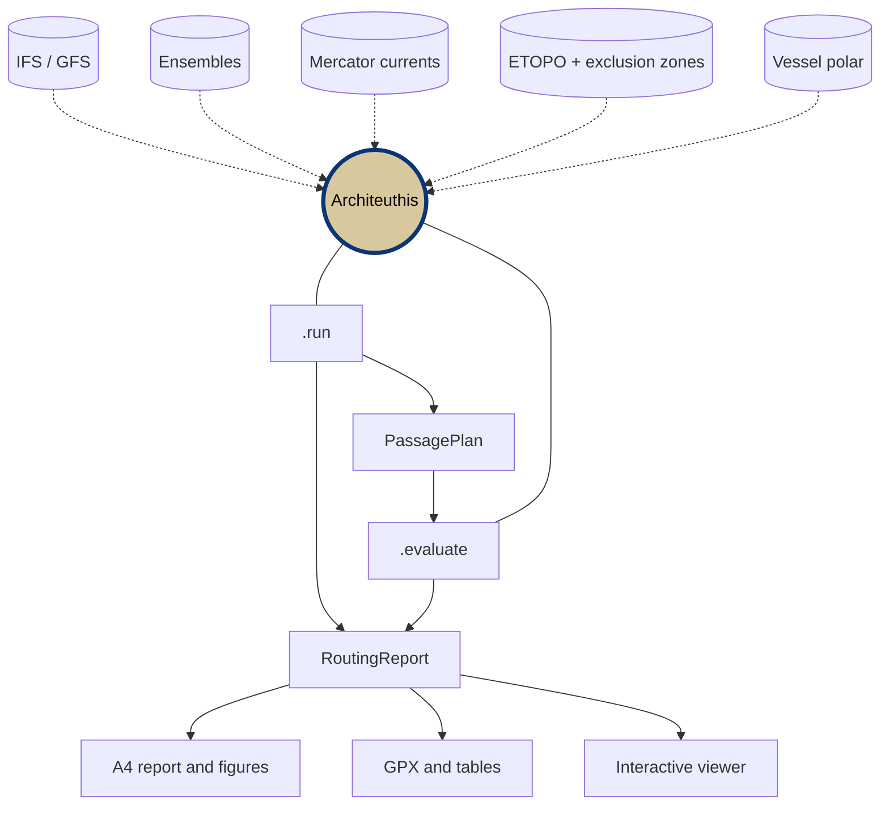

<!-- Logo placeholder: add the file at media/logo-architeuthis-color.png -->


<div align="center">

# Architeuthis: Weather Routing for Motor and Hybrid Vessels 🦑

**Minimize fuel on a fixed schedule, with real forecasts and your own vessel model.**

<!-- Badges -->

[](https://pypi.org/project/architeuthis/)
[](https://pypi.org/project/architeuthis/)
[](https://github.com/julesricheux/Architeuthis/actions/workflows/tests.yml)
[](https://pepy.tech/projects/architeuthis)
[](LICENSE)

## 📚 [User Guide](docs/user_guide.md) | 🖼️ [Examples](examples/README.md) | ❔ [Issues](https://github.com/julesricheux/Architeuthis/issues)

<!-- (Badges) -->

</div>

---

## What is Architeuthis?

An open-source marine weather and decision-making framework for hybrid sailing ships. It couples mesh-free, fully differentiable methods in a unified optimization environment to compute optimal routes under real-world constraints.

"Mesh-free" means that routes are not searched on a graph. The waypoints are continuous variables of a single nonlinear program, and weather, bathymetry and vessel performance are differentiable tables queried at those waypoints. [CasADi](https://github.com/casadi/casadi) differentiates through everything and [IPOPT](https://github.com/coin-or/Ipopt) solves the problem.

**Key Features:**
- ⛽ **Fuel-optimal routes** - Minimize the fuel of a voyage with a fixed departure and arrival time
- 🚢 **Motor and hybrid vessels** - Bring your vessel as a performance table, with or without sails
- 🌊 **Wind, waves and currents** - Ready-made IFS, GFS, ensemble and Mercator sources
- 🧊 **Real-world constraints** - Land, shallow water, exclusion zones, the iceberg limit, maximum power and your own constraints
- 🎲 **Forecast uncertainty** - Optimize each ensemble member, and test a plan against other models, members or vessels
- 📊 **Ready-to-use outputs** - A4 reports, maps, tables, GPX tracks and an interactive viewer

**Keywords:** weather routing, voyage optimization, fuel saving, wind-assisted ship propulsion, hybrid vessel, passage planning, nonlinear programming, CasADi, IPOPT, GRIB2, xarray, python

---

## Quick Start

### Installation

Architeuthis needs Python 3.11 or later.

**With pip:**
```bash
pip install architeuthis
```

Add the interactive viewer with:
```bash
pip install "architeuthis[app]"
```

**From source, with conda:**
```bash
git clone https://github.com/julesricheux/Architeuthis.git
```
```bash
cd Architeuthis
```
```bash
conda env create -f environment.yaml
```

The environment is named `py313-architeuthis`. The package then needs no installation: run everything from the repository root.

### Simple Example

This example routes a vessel across the North Atlantic with recent ECMWF forecasts. It needs no credentials, only a polar file for your vessel (see [Your Vessel](#your-vessel)).

```python
import pandas as pd

from architeuthis import presets
from architeuthis.common import Domain
from architeuthis.core import RoutingAnalysis
from architeuthis.report import ReportCollection
from architeuthis.route import Route, Waypoint
from architeuthis.toolbox.plot_utils import plot_report
from architeuthis.voyage import Voyage

domain = Domain(min_lon=-60., max_lon=0., min_lat=38., max_lat=56.)

# Yesterday's 00 UTC forecast, with its lead times in hours
today = pd.Timestamp("now").floor("1d")
date = today - pd.Timedelta(days=1)
steps = list(range(0, 145, 3)) + list(range(150, 241, 6))

atmosphere = presets.atmosphere("ifs", domain, date=date, fxx=steps)
wave = presets.wave("ifs", domain, date=date, fxx=steps)
current = presets.calm_current(atmosphere)  # presets.current_mercator needs a Copernicus Marine account
topography = presets.topography(domain)

# Specific fuel consumption in g/kWh, loads and power in kW
vessel = presets.vessel("my_vessel_polar.nc", sfc=220., hotel_load=194., max_power=4100.)

# The reference route and the schedule, in UTC
route = Route("crossing", [Waypoint(47.725, -4.380, "Penmarch"), Waypoint(46.551, -53.321, "Cape Race")])
voyage = Voyage("crossing", etd=today, eta=today + pd.Timedelta(days=8), route=route)

# Optimize
analysis = RoutingAnalysis("crossing", vessel, voyage, atmosphere, wave, current, topography)
report = analysis.run()

# Results
reports = ReportCollection([report])
print(reports.summary())
reports.to_gpx()     # a track for your navigation system
reports.save()       # for the viewer
plot_report(report)  # one A4 page: speed, sails, power, waves and wind against time
```

---

## Your Vessel

Architeuthis does not include a vessel model. You provide a NetCDF performance table, which can come from a velocity prediction program, sea trials or a simpler model. A motor vessel and a hybrid vessel only differ by the content of this table: for a motor vessel, `sails_contribution` is zero.

| Variable | Meaning | Unit |
| --- | --- | --- |
| `bhp` | Average brake power | kW |
| `max_bhp` | Brake power with load fluctuations, checked against `max_power` | kW |
| `sails_contribution` | Share of the propulsion from sails, for the reports | % |

Each variable has the five dimensions below, in this order:

| Dimension | Meaning | Unit |
| --- | --- | --- |
| `stw` | Speed through water | kt |
| `tws` | True wind speed | kt |
| `twa` | True wind angle, 0 to 180 | deg |
| `hs` | Significant wave height | m |
| `wa` | Wave angle, 0 to 180 | deg |

`sfc` and `hotel_load` are given to `presets.vessel` as constants or as functions of the power, and `sfc` must be set because the objective is zero without it. A polar named `..._eff45.nc` gets the label `eff45` in reports, or you can give any `label`.

---

## Supported Data Sources

| Source | Data | In Architeuthis | Credentials |
| --- | --- | --- | --- |
| **[ECMWF IFS](https://www.ecmwf.int/en/forecasts/datasets/open-data)** | Wind, gust, waves | `presets.atmosphere("ifs")`, `presets.wave("ifs")` | None |
| **ECMWF IFS ensemble** | Wind, waves, for each member | `presets.ensemble_atmosphere()`, `presets.ensemble_wave()` | None |
| **[NOAA GFS](https://www.noaa.gov/information-technology/open-data-dissemination)** | Wind, gust, waves | `presets.atmosphere("gfs")`, `presets.wave("gfs")` | None |
| **[ECCC HRDPS](https://eccc-msc.github.io/open-data/msc-data/nwp_hrdps/readme_hrdps-datamart_en/)** | High-resolution wind, Canada | `presets.hrdps_atmosphere()` ⚠️ | None |
| **[Mercator SMOC](https://marine.copernicus.eu/)** | Currents | `presets.current_mercator()` | `CMEMS_USER`, `CMEMS_PWD` |
| **[ETOPO 2022](https://www.ncei.noaa.gov/products/etopo-global-relief-model)** | Land and bathymetry | `presets.topography()` | None |
| **[International Ice Patrol](https://www.navcen.uscg.gov/international-ice-patrol-overview)** | Iceberg limit | `exclusion.default_exclusion_zones()` | None |
| **[ERA5](https://cds.climate.copernicus.eu/)** | Reanalysis | `forecast.CDSForecast` | `CDS_API_KEY` |
| **[EUMETSAT](https://www.eumetsat.int/)** | ASCAT and Poseidon observations, to validate forecasts | `satellite.ASCATData`, `satellite.PoseidonData` | `EUMDAC_USER`, `EUMDAC_PWD` |

⚠️ HRDPS wind speeds are right, but its wind direction is not reliable yet: its components are not rotated from the model's rotated grid, which is about 45° off around Saint-Pierre-et-Miquelon.

Credentials are read from environment variables, and downloads are cached under `~/data/`. Another source can be added by subclassing `ArchiteuthisData`. Each provider's own terms of use apply to its data.

---

## Core Capabilities



### The Routing Problem

- **Objective:** total fuel, `sum((bhp + hotel_load) * dt * sfc) / 1e6`, in tonnes.
- **Fixed:** departure and arrival, ETD and ETA. The schedule is a requirement and the speed is an outcome.
- **Variables:** the positions along the route, and optionally a factor that blends the reference route towards two alternatives.
- **Constraints:** by default, brake power below `max_power` and every position in navigable water. Your own constraints can replace them.

### Python API

```python
# Optimize, or evaluate the reference route at constant speed as a baseline
report = analysis.run()
baseline = analysis.run(solve=False, solver_options={"ipopt": {"linear_solver": "mumps"}})

# Test a plan, positions fixed, with another vessel, forecast or ensemble member
other_model = RoutingAnalysis("gfs", vessel, voyage, gfs_atmosphere, gfs_wave, current, topography)
evaluation = other_model.evaluate(analysis.passage_plan)

# Add entries to a report, and compare several reports
report = analysis.run(tags={"study": "winter"})
reports.select(vessel="eff45", solve=1).summary()

# Store what you want to reuse
RouteLibrary().save(route)               # ~/data/route_library/
PassagePlanLibrary().save(analysis.passage_plan)  # ~/data/passage_plans/
ExclusionZoneLibrary().save(zone)        # ~/data/exclusion_zones/

# Add your own constraints
analysis.run(constraints=lambda ctx: [ctx["max_bhp"] < 3000., ctx["z"] < -5.])
```

### Interactive Viewer

From a source checkout, start the Dash viewer from the `architeuthis/` folder. It displays the latest routes saved with `reports.save()`, over forecast fields and exclusion zones, on port 8052.

```bash
cd architeuthis
```
```bash
python ui.py
```

### Good to Know

Architeuthis is a decision-support tool: its routes do not replace the judgment of the crew, or the checks of a navigation system.

- **Check the result:** failures return the last iterate, so read `report["status"]` (1 solved, 2 failed) and `max(report["z"])` (positive means land or an exclusion zone).
- **Past the forecast horizon,** fields fade to zero and read as calm conditions, so schedules should stay within the lead times.
- **Not modelled:** leeway. Wind and wave angles are relative to the course over ground.
- **Not supported:** routes that cross the antimeridian.
- **Windows:** with casadi 3.7, `run(solve=False)` with the default solver options crashes, so pass `linear_solver: mumps` as above.
- **Iceberg limit:** offline, with no earlier download, routing runs without it and gives a warning.

---

## Documentation & Help

📘 **[User Guide](docs/user_guide.md)** - Data sources, reports, every figure and its options, exclusion zones and the viewer

🖼️ **[Examples](examples/README.md)** - One script per use, with its settings at the top

| To learn | Read |
| --- | --- |
| A first routing, in the fewest lines | [`post_leg_rewind.py`](examples/post_leg_rewind.py) |
| Every step of a study | [`simple_routing.py`](examples/simple_routing.py) |
| Stored routes and passage plans, restarting from a position at sea | [`passage_planning.py`](examples/passage_planning.py) |
| Testing a plan with another model | [`ifs_route_tested_with_gfs.py`](examples/ifs_route_tested_with_gfs.py) |
| Several starting routes, and the spread of an ensemble along a route | [`long_term_routing.py`](examples/long_term_routing.py) |
| One optimization per ensemble member | [`ensemble_routing.py`](examples/ensemble_routing.py) |
| High-resolution wind on a short leg | [`short_term_routing.py`](examples/short_term_routing.py) |
| Comparing forecasts with satellite observations | [`comparison_ascat_models.py`](examples/comparison_ascat_models.py) |

🗓️ **[Changelog](CHANGELOG.md)** and **[Roadmap](ROADMAP.md)** - What changed and what is planned

🚑 **[Report Issues](https://github.com/julesricheux/Architeuthis/issues)** - Found a bug? Let us know

---

## Citation & Acknowledgment

If Architeuthis played an important role in your work, please [tell us about it](https://github.com/julesricheux/Architeuthis/issues)!

### Suggested Citation

> Richeux, J. (YEAR). Architeuthis: Marine weather and decision-making framework for hybrid sailing ships (Version x.y.z) [Computer software]. https://github.com/julesricheux/Architeuthis

### Credits

Architeuthis stands on the work of others, with our thanks:

- **[AeroSandbox](https://github.com/peterdsharpe/AeroSandbox)** by Peter D. Sharpe (MIT). The `numpy`, `optimization` and `modeling` packages are adapted from version 4.2.9.
- **[Herbie](https://github.com/blaylockbk/Herbie)** by Brian K. Blaylock (MIT) downloads the forecasts, and its README inspired the structure of this one.
- **[CasADi](https://github.com/casadi/casadi)** (LGPL) and **[IPOPT](https://github.com/coin-or/Ipopt)** (EPL) differentiate and solve the routing problem.
- **[Copernicus Marine Toolbox](https://github.com/mercator-ocean/copernicus-marine-toolbox)**, **[xarray](https://github.com/pydata/xarray)**, **[Cartopy](https://github.com/SciTools/cartopy)**, **[Dash](https://github.com/plotly/dash)** and the other dependencies listed in [`pyproject.toml`](pyproject.toml).
- The forecast, ocean, relief and ice data of the providers listed under [Supported Data Sources](#supported-data-sources).

---

## License

Architeuthis is free software, distributed under the [GNU General Public License v3](LICENSE). You may use, study, share and modify it under the terms of this license, and it comes without any warranty.

Code adapted from AeroSandbox stays under its original MIT license:

<details>
<summary>AeroSandbox MIT license</summary>

```text
MIT License

Copyright (c) 2019-2023 Peter Sharpe

Permission is hereby granted, free of charge, to any person obtaining a copy
of this software and associated documentation files (the "Software"), to deal
in the Software without restriction, including without limitation the rights
to use, copy, modify, merge, publish, distribute, sublicense, and/or sell
copies of the Software, and to permit persons to whom the Software is
furnished to do so, subject to the following conditions:

The above copyright notice and this permission notice shall be included in all
copies or substantial portions of the Software.

THE SOFTWARE IS PROVIDED "AS IS", WITHOUT WARRANTY OF ANY KIND, EXPRESS OR
IMPLIED, INCLUDING BUT NOT LIMITED TO THE WARRANTIES OF MERCHANTABILITY,
FITNESS FOR A PARTICULAR PURPOSE AND NONINFRINGEMENT. IN NO EVENT SHALL THE
AUTHORS OR COPYRIGHT HOLDERS BE LIABLE FOR ANY CLAIM, DAMAGES OR OTHER
LIABILITY, WHETHER IN AN ACTION OF CONTRACT, TORT OR OTHERWISE, ARISING FROM,
OUT OF OR IN CONNECTION WITH THE SOFTWARE OR THE USE OR OTHER DEALINGS IN THE
SOFTWARE.
```

</details>

---

## Contributing

We welcome contributions! Here's how you can help:

- ⭐ Star this repository
- 🐛 Report bugs or suggest features via [Issues](https://github.com/julesricheux/Architeuthis/issues)
- 🧪 Try it on your own vessel and share what you find
- 📝 Improve the documentation and the examples
- 💻 Submit pull requests: work from `develop`, and target `main`

The tests need no network access or credentials:

```bash
python -m pip install -e ".[test]"
```
```bash
python -m pytest
```

---

## Alternative Tools

- **[WeatherRoutingTool](https://github.com/52North/WeatherRoutingTool)** by 52°North - Another open-source Python tool for ship weather routing
- **[OpenCPN Weather Routing plugin](https://github.com/rgleason/weather_routing_pi)** - Weather routing inside a chart plotter, popular for sailing

---

## About the Author

**Thanks for using Architeuthis, and fair winds!** 🦑

Jules Richeux - [GitHub](https://github.com/julesricheux)
